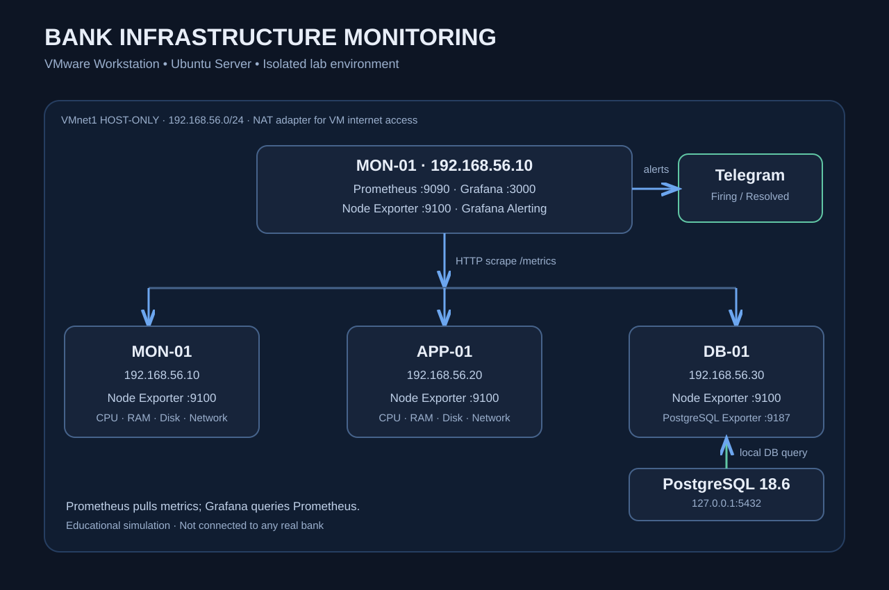

# Bank Infrastructure Monitoring

Учебный проект мониторинга инфраструктуры, моделирующей три серверных узла банка. Развёрнут в изолированной лаборатории VMware Workstation; **не подключён к инфраструктуре реального банка**.

## Цель

Собирать системные метрики с Linux-серверов и метрики PostgreSQL, визуализировать их в Grafana и отправлять уведомления о сбоях через Telegram.

## Архитектура



| Узел | IP (Host-only) | Компоненты |
| --- | --- | --- |
| MON-01 | `192.168.56.10` | Prometheus `:9090`, Grafana `:3000`, Node Exporter `:9100` |
| APP-01 | `192.168.56.20` | Node Exporter `:9100` |
| DB-01 | `192.168.56.30` | PostgreSQL `127.0.0.1:5432`, PostgreSQL Exporter `:9187`, Node Exporter `:9100` |

Сеть VMware: VMnet1 Host-only `192.168.56.0/24` для взаимодействия компонентов и отдельный NAT-интерфейс для доступа виртуальных машин в интернет. PostgreSQL слушает loopback, а PostgreSQL Exporter доступен Prometheus по Host-only сети.

**Потоки данных:** Prometheus периодически опрашивает HTTP `/metrics` у Node Exporter и PostgreSQL Exporter; Grafana запрашивает данные из Prometheus; Grafana Alerting отправляет уведомления в Telegram. Экспортеры не отправляют метрики в Prometheus самостоятельно.

## Технологии

- Ubuntu Server и VMware Workstation
- Prometheus 2.53.5 (версия, использованная в лаборатории)
- Grafana
- Prometheus Node Exporter
- PostgreSQL 18.6 и PostgreSQL Exporter
- Grafana Alerting и Telegram Bot

## Дашборды

### Bank Infrastructure Monitoring

Создан вручную в Grafana: CPU Usage, RAM Usage, Disk Usage, Network Traffic (RX/TX), System Load (1m/5m/15m), Server Availability.

### PostgreSQL Database Monitoring

Создан вручную: PostgreSQL Availability (`pg_up`), Database Connections, Transactions per Second (commit/rollback), Database Size, Deadlocks (5m). Набор доступных метрик зависит от версии Exporter.

## Основные PromQL-запросы

### Доступность Node Exporter

```promql
up{instance=~"192\\.168\\.56\\.(10|20|30):9100"}
```

`up=1` означает успешный scrape Exporter, а не гарантированную работоспособность всех сервисов сервера.

### CPU Usage, %

```promql
100 * (1 - avg by(instance) (rate(node_cpu_seconds_total{instance=~"192\\.168\\.56\\.(10|20|30):9100",mode="idle"}[5m])))
```

### Available RAM, %

```promql
100 * node_memory_MemAvailable_bytes{instance=~"192\\.168\\.56\\.(10|20|30):9100"} / node_memory_MemTotal_bytes{instance=~"192\\.168\\.56\\.(10|20|30):9100"}
```

### Root filesystem usage, %

```promql
100 * (1 - node_filesystem_avail_bytes{instance=~"192\\.168\\.56\\.(10|20|30):9100",mountpoint="/",fstype!~"tmpfs|overlay|squashfs"} / node_filesystem_size_bytes{instance=~"192\\.168\\.56\\.(10|20|30):9100",mountpoint="/",fstype!~"tmpfs|overlay|squashfs"})
```

### Network RX/TX, Mbit/s

```promql
rate(node_network_receive_bytes_total{instance=~"192\\.168\\.56\\.(10|20|30):9100",device!~"lo|veth.*|docker.*"}[5m]) * 8 / 1000000
rate(node_network_transmit_bytes_total{instance=~"192\\.168\\.56\\.(10|20|30):9100",device!~"lo|veth.*|docker.*"}[5m]) * 8 / 1000000
```

### System load

```promql
node_load1{instance=~"192\\.168\\.56\\.(10|20|30):9100"}
node_load5{instance=~"192\\.168\\.56\\.(10|20|30):9100"}
node_load15{instance=~"192\\.168\\.56\\.(10|20|30):9100"}
```

### PostgreSQL

```promql
up{job="postgresql"}
pg_up{job="postgresql"}
pg_stat_database_numbackends{job="postgresql",datname="postgres"}
rate(pg_stat_database_xact_commit{job="postgresql",datname="postgres"}[5m])
rate(pg_stat_database_xact_rollback{job="postgresql",datname="postgres"}[5m])
pg_database_size_bytes{job="postgresql",datname="postgres"}
increase(pg_stat_database_deadlocks{job="postgresql",datname="postgres"}[5m])
```

`up{job="postgresql"}=1` означает, что Exporter доступен; `pg_up=1` означает, что Exporter успешно подключился к PostgreSQL.

## Prometheus: пример конфигурации scrape

```yaml
scrape_configs:
  - job_name: node_exporter
    static_configs:
      - targets:
          - 192.168.56.10:9100
          - 192.168.56.20:9100
          - 192.168.56.30:9100
  - job_name: postgresql
    static_configs:
      - targets: ['192.168.56.30:9187']
        labels:
          server: DB-01
          environment: lab
```

Проверка конфигурации и перезапуск:

```bash
sudo promtool check config /etc/prometheus/prometheus.yml
sudo systemctl restart prometheus
```

## Telegram Alerting

Grafana → **Alerting → Notification configuration → Contact points**: Telegram Contact Point `telegram-bank-monitoring` с токеном бота и Chat ID. Notification policy маршрутизирует уведомления в этот Contact Point.

| Правило | Условие | Pending | Статус |
| --- | --- | --- | --- |
| `BANK - Server Down` | `up` ниже 1 | 1 мин | Проверены Firing и Resolved в Telegram |
| `BANK - High CPU Usage` | CPU выше 90% | 5 мин | Настроено; нагрузочный тест отдельно не подтверждён |
| `BANK - Low Available Memory` | Available RAM ниже 10% | 3 мин | Требует подтверждения сохранения и теста |
| `BANK - Disk Almost Full` | Root disk usage выше 90% | 2 мин | Требует подтверждения сохранения и теста |
| `BANK - PostgreSQL Down` | `pg_up` ниже 1 | 1 мин | Не реализовано в текущей версии |

## Проверка инцидента (выполнена)

На APP-01 в учебном стенде:

```bash
sudo systemctl stop prometheus-node-exporter
# Дождаться up=0 и уведомления Firing
sudo systemctl start prometheus-node-exporter
# Дождаться up=1 и уведомления Resolved
```

Подтверждены получение Firing и Resolved в Telegram; восстановление пришло с задержкой.

Учебный проект для демонстрации практических навыков мониторинга Linux и PostgreSQL. Развёрнут и настроен вручную.
